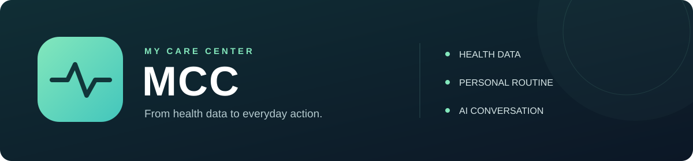
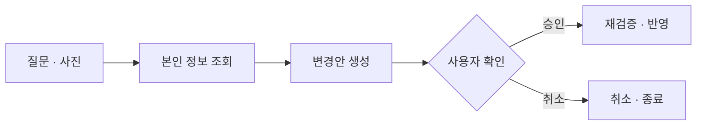

### 흩어진 건강정보를 모아, 일상 속 실천으로 연결하다

건강자료 분석부터 맞춤 루틴과 수행 기록까지 연결하는 AI 건강관리 서비스 
멋쟁이사자처럼 중앙해커톤 · 2026.08

  <a href="docs/MCC_project_public.pdf"><strong>프로젝트 소개서</strong></a>
  ·
  <a href="docs/chatbot-design.md"><strong>챗봇 설계</strong></a>
  ·
  <a href="https://github.com/likelion-team3-main-hackathon/backend">Backend</a>
  ·
  <a href="https://github.com/likelion-team3-main-hackathon/frontend">Frontend</a>

  
  
  
  
  

---

<strong>목차</strong>

- [프로젝트 소개](#프로젝트-소개)
- [주요 기능](#주요-기능)
- [나의 기여](#나의-기여)
- [챗봇 아키텍처](#챗봇-아키텍처)
- [기술 스택](#기술-스택)
- [문서 및 실행 안내](#문서-및-실행-안내)

## 프로젝트 소개

**MCC는 건강 상태를 이해하는 데서 끝나지 않고, 다음 행동까지 이어지도록 만든 서비스입니다.**

식단·운동 기록, 체성분과 건강 문서가 따로 관리되면 사용자는 자신의 상태를 종합적으로 파악하기 어렵습니다. MCC는 이 정보를 모아 개인별 루틴을 제안하고, 실천과 변화 확인까지 하나의 흐름으로 연결합니다.

이 Repository는 팀 프로젝트의 **Gemini AI 챗봇 개발과 채팅 화면 연동 경험**을 정리한 개인 포트폴리오입니다. 서비스 원본 코드는 팀 Backend·Frontend Repository에서 관리합니다.

## 주요 기능

| 건강정보 이해 | 맞춤 루틴과 기록 | 대화형 AI |
| :--- | :--- | :--- |
| 프로필·건강 문서·사진을 바탕으로 분석 결과 확인 | 식단·운동 루틴을 생성하고 수행·체중·컨디션 기록 관리 | 본인 정보를 조회하고 사용자 확인 후 루틴·기록 변경 |

건강정보 분석, 루틴 생성과 분석실은 팀 전체의 기능입니다. 직접 담당한 부분은 아래의 챗봇과 채팅 화면 연동입니다.

### 챗봇 사용 예시

| 사용자의 요청 | 처리 방식 |
| --- | --- |
| “이번 주 운동을 얼마나 했어?” | 본인의 수행 기록을 조회한 뒤 답변 |
| “오늘 걷기 운동을 15분으로 줄여줘.” | 현재 루틴을 확인하고 변경안 제시 → 사용자 승인 후 반영 |
| “오늘 체중을 70.5kg으로 기록해줘.” | 입력값을 확인하고 기록 변경안 제시 → 사용자 승인 후 저장 |

기록이 부족하거나 요청의 대상이 불명확하면 안내 또는 추가 질문으로 이어집니다. 예시의 수치와 문장은 설명용입니다.

## 나의 기여

**AI가 자연어를 해석하는 단계와 서버가 실제 데이터를 검증·실행하는 단계를 나눠 구현했습니다.**

### 1. 질문을 실제 사용자 데이터와 연결

**미리 정의한 DB View를 중심으로 챗봇의 데이터 접근 가드레일을 설계했습니다.** AI가 요청과 무관한 개인정보까지 불필요하게 조회하지 않도록, 기능별로 필요한 사용자 정보만 미리 묶어 제공하기 위한 설계입니다. 여러 테이블을 조인하고 필요한 컬럼을 선별해 조회용 View를 구성했으며, AI는 SQL이나 조인을 직접 생성하는 대신 질문에 맞는 허용된 조회 도구와 조건을 선택하도록 했습니다. 서버가 해당 View 등 미리 정해진 조회 로직으로 본인 데이터를 가져오면, AI는 조회된 실제 값과 식별자를 바탕으로 답변하거나 실행할 변경안을 구체화합니다. 이를 통해 AI의 판단 범위를 사전에 정의한 데이터와 작업 안으로 제한하고, 변경은 사용자 확인과 서버 검증을 거쳐 실행하도록 연결했습니다.

- Gemini가 필요한 정보를 선택하고, 서버에서 조회한 결과로 답변·변경안을 생성하는 두 단계 흐름을 구현했습니다.
- 로그인한 사용자를 기준으로 조회 범위를 제한하고, 대상 데이터의 소유권을 확인했습니다.
- 사용자별 대화방·메시지·첨부 이미지를 저장하고 이전 대화와 연결했습니다.

### 2. 확인을 거친 데이터 변경

- AI의 제안을 바로 실행하지 않고 사용자에게 확인·취소할 수 있는 변경안으로 제공했습니다.
- 승인 시 현재 상태를 다시 검증하고, 이미 처리된 변경안의 재실행을 제한했습니다.
- 여러 루틴 항목의 변경을 하나의 승인 흐름으로 묶고 관련 DB 변경을 트랜잭션으로 처리했습니다.

### 3. 채팅 화면과 팀 기능 연동

- 질문 전송·이미지 첨부·변경안 승인·취소·결과 표시를 React 화면과 연결했습니다.
- 조회 범위와 변경 흐름 테스트를 작성하고, 다른 팀 기능의 변경사항을 병합·연동했습니다.

**대표 구현:** [챗봇 초기 구현](https://github.com/likelion-team3-main-hackathon/backend/commit/c988d7d91a33678382c6527651bb657d5f3e88b6) · [복합 요청 처리](https://github.com/likelion-team3-main-hackathon/backend/commit/556f39f9a21ba4441fd5d5beeec77f95e7bdd518) · [채팅 화면 연동](https://github.com/likelion-team3-main-hackathon/frontend/commit/285c480)

<strong>테스트와 검증 범위</strong>

보관된 **2026.08.18 실행 보고서에서 챗봇 변경 흐름 통합 테스트 7개가 실패·오류 없이 통과**했습니다. 본인 정보 조회, 타인 대상 접근 거부, 승인·취소, 실행 시 재검증과 여러 변경의 반영 등을 다루는 테스트를 작성했습니다.

[커밋별 기여와 검증 기록 자세히 보기 →](docs/contributions.md)

## 챗봇 아키텍처

자연어 요청을 **조회 → 제안 → 확인 → 실행**으로 연결합니다. 아래는 데이터 변경 요청의 흐름이며, 일반 조회는 답변으로 마무리합니다.

**핵심 설계:** 사용자 소유권 확인 · 승인 시 재검증 · 변경안 상태 관리 · 관련 DB 변경의 트랜잭션 처리

[조회·응답·변경 흐름과 DTO 예시 보기 →](docs/chatbot-design.md)

## 기술 스택

| 영역 | 기술 |
| --- | --- |
| Backend · AI | Java 21, Spring Boot 3.5, Gemini API |
| Data | Spring Data JPA, MySQL 8, Flyway |
| Chat UI | React, JavaScript, CSS |
| Test | JUnit 5, Spring Boot Test, AssertJ |
| 팀 실행 환경 | Docker Compose, Redis, MinIO |

## 문서 및 실행 안내

- **[프로젝트 소개서](docs/MCC_project_public.pdf)** — 서비스의 문제 정의와 주요 기능
- **[챗봇 설명서](docs/MCC_chatbot_public.pdf)** — 질문 예시, 처리 구조와 DTO
- **[설계 문서](docs/chatbot-design.md)** — 조회·변경·승인 흐름과 설계 판단
- **[기여 기록](docs/contributions.md)** — 담당 범위, 주요 커밋과 검증 결과

서비스 실행은 팀 [Backend 실행 가이드](https://github.com/likelion-team3-main-hackathon/backend#로컬-실행)와 [Frontend 실행 가이드](https://github.com/likelion-team3-main-hackathon/frontend#로컬-실행)를 참고하세요.

공개용 PDF에서는 계정 정보와 내부 운영 세부사항을 제외했습니다. DTO 예시의 내부 호출 식별자는 설명용 이름으로 일반화했습니다.
