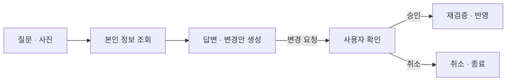

# MCC · MY CARE CENTER

### 건강정보를 일상 속 실천으로 연결하는 AI 건강관리 서비스

**흩어진 건강정보를 모아 이해하고, 나에게 맞는 루틴을 만들고, 대화로 확인·조정하는 경험을 구현했습니다.**

    

[팀 Backend](https://github.com/likelion-team3-main-hackathon/backend) · [팀 Frontend](https://github.com/likelion-team3-main-hackathon/frontend) · [나의 역할](#나의-역할) · [챗봇 설계](docs/chatbot-design.md) · [구현 근거](docs/contributions.md)

## 프로젝트 소개

식단, 운동, 체성분과 건강 문서가 서로 떨어져 있으면 현재 상태를 파악하고 다음 행동을 정하기 어렵습니다. MCC는 사용자의 프로필과 건강자료를 기반으로 분석 결과, 식단·운동 루틴, 수행 기록과 변화 확인을 하나의 흐름으로 연결한 중앙해커톤 팀 프로젝트입니다.

| 항목 | 내용 |
| --- | --- |
| 프로젝트 | MCC — MY CARE CENTER |
| 활동 | 멋쟁이사자처럼 중앙해커톤 · 2026년 8월 |
| 나의 담당 | Gemini AI 챗봇 백엔드 · 채팅 화면 및 API 연동 |
| 이 Repository | 프로젝트 소개, 개인 기여, 챗봇 설계와 구현 근거를 정리한 포트폴리오 |
| 원본 코드 | 팀 Organization의 Backend·Frontend Repository에서 관리 |

## 서비스에서 할 수 있는 일

| 흐름 | 팀 서비스의 주요 기능 |
| --- | --- |
| 정보 모으기 | 건강 목표·생활 습관 입력, 건강 문서와 사진 업로드 |
| 상태 이해하기 | 건강자료 분석 결과와 주요 정보 확인 |
| 계획 세우기 | 개인별 식단·운동 루틴 생성 및 조회 |
| 실천 기록하기 | 식사·운동·체중·컨디션 기록과 수행 상태 관리 |
| 변화 확인하기 | 기록과 측정값의 추이를 분석실에서 확인 |
| 대화로 연결하기 | 챗봇으로 본인 정보를 조회하고, 확인을 거쳐 루틴·기록 변경 |

위 표는 팀 전체의 구현 범위입니다. 아래에서는 직접 담당한 챗봇과 화면 연동을 중심으로 설명합니다.

## 나의 역할

**Gemini AI 챗봇이 자연어 요청을 실제 서비스 기능으로 연결하도록 구현했습니다.** 질문에 필요한 사용자 정보를 먼저 조회하고, 그 결과를 바탕으로 답변하거나 변경안을 제안하도록 구성했습니다. 변경은 즉시 실행하지 않고 사용자의 확인을 받은 뒤 서버가 다시 검증하도록 했습니다.

| 담당 영역 | 구현 내용 |
| --- | --- |
| 질문과 데이터 연결 | 필요한 정보를 선택하는 단계와 조회 결과로 답변·변경안을 생성하는 단계를 분리 |
| 본인 정보 조회 | 서버에서 확인한 로그인 사용자 기준으로 건강정보·루틴·기록 조회 |
| 변경안 처리 | 변경안 생성, 확인·취소, 실행 전 재검증과 처리 상태 관리 |
| 복합 요청 | 여러 루틴 항목의 수정·일정 이동 등을 하나의 변경안으로 처리 |
| 대화 이력 | 대화방·메시지·첨부 이미지 저장 및 재조회 |
| 프론트 연동 | 질문 전송, 이미지 첨부, 변경안 확인·취소와 결과 표시 |
| 테스트와 협업 | 조회 범위·변경 흐름 테스트 작성, 팀 기능과의 병합·연동 |

## 챗봇은 이렇게 동작합니다

예를 들어 **“오늘 걷기 운동을 30분에서 15분으로 줄여줘”**라고 요청하면 현재 루틴을 확인하고 변경안을 보여줍니다. 사용자가 확인한 뒤에 실제 변경을 반영합니다.

일반 조회는 답변으로 마무리하고, 정보가 부족하면 추가 질문을 반환합니다. 데이터 변경이 필요한 경우에만 확인 절차로 이어집니다. 사진은 필요한 경우 답변 생성에 함께 활용합니다.

## 설계에서 중요하게 본 것

| 문제 | 구현한 처리 |
| --- | --- |
| AI가 실제 상태를 모른 채 답하거나 변경을 제안할 수 있음 | 서비스에서 조회한 정보를 바탕으로 최종 답변·변경안 생성 |
| 요청에 다른 사용자의 식별자가 섞일 수 있음 | 서버가 확인한 사용자와 데이터 소유권을 기준으로 조회·변경 범위 제한 |
| 제안 이후 실제 데이터 상태가 바뀔 수 있음 | 변경안 준비 시점과 사용자가 승인한 시점에 검증 수행 |
| 같은 변경을 여러 번 실행할 수 있음 | 변경안 상태 확인과 실행 구간의 동시성 제어 |
| 여러 변경 중 일부만 저장되면 상태가 어긋날 수 있음 | 관련 DB 변경을 하나의 트랜잭션으로 처리 |
| 대화가 화면을 닫으면 사라질 수 있음 | 사용자별 대화 이력 저장과 재조회 연결 |

[설계 흐름과 처리 예시 자세히 보기 →](docs/chatbot-design.md)

## 구현 근거와 검증

| 확인할 내용 | 자료 |
| --- | --- |
| 챗봇 초기 구현 | [Gemini 챗봇 구현 커밋](https://github.com/likelion-team3-main-hackathon/backend/commit/c988d7d91a33678382c6527651bb657d5f3e88b6) |
| 복합 요청 처리 확장 | [여러 변경 작업 처리 커밋](https://github.com/likelion-team3-main-hackathon/backend/commit/556f39f9a21ba4441fd5d5beeec77f95e7bdd518) |
| 조회·변경 기능 확장 | [챗봇 기능 확장 커밋](https://github.com/likelion-team3-main-hackathon/backend/commit/a1220438195947382936c41c06e16cbca9277e1f) |
| 채팅 화면 연동 | [Frontend 연동 커밋](https://github.com/likelion-team3-main-hackathon/frontend/commit/285c480) |

보관된 **2026.08.18 테스트 보고서에서는 챗봇 변경 흐름 테스트 7개가 실패·오류 없이 통과**한 것을 확인했습니다. 이 수치는 당시 실행 결과이며, 전체 서비스 테스트나 실제 Gemini 응답 품질을 모두 검증했다는 의미는 아닙니다.

[담당 범위·커밋·테스트 확인 내용 →](docs/contributions.md)

## 기술 스택

| 영역 | 사용 기술 |
| --- | --- |
| 챗봇 백엔드 | Java 21 · Spring Boot 3.5 · Gemini API |
| 데이터·검증 | Spring Data JPA · MySQL · Flyway · Bean Validation |
| 채팅 화면 | React · JavaScript · CSS |
| 테스트 | JUnit 5 · Spring Boot Test · AssertJ |
| 팀 실행 환경 | Docker Compose · Redis · MinIO |

## 상세 자료

- [프로젝트 소개 PDF](docs/MCC_project_public.pdf)
- [챗봇 설계·사용 예시 PDF](docs/MCC_chatbot_public.pdf)
- [챗봇 설계 문서](docs/chatbot-design.md)
- [개인 기여와 검증 기록](docs/contributions.md)

PDF는 계정 정보와 내부 운영 세부사항을 제외한 공개용 자료입니다. 포트폴리오의 JSON 예시는 설명용이며 내부 호출 식별자는 일반화했습니다.
