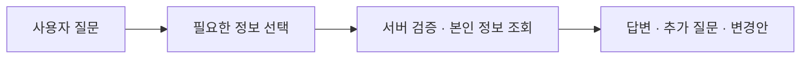
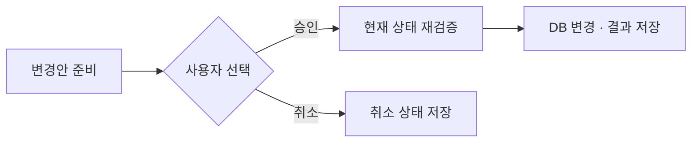

# 챗봇 설계와 처리 흐름

[← 프로젝트 소개](../README.md) · [기여와 검증 기록](contributions.md)

## 구현 목표

사용자가 여러 메뉴를 찾아다니지 않고 대화로 자신의 루틴과 기록을 확인하고 조정할 수 있도록 했습니다. AI가 요청을 해석하고, 서버가 실제 데이터 조회·검증·실행을 담당하도록 책임을 나눴습니다.

## 조회와 응답 생성

첫 번째 AI 호출에서 질문에 필요한 정보의 종류를 선택합니다. 서버는 허용된 조회인지 확인하고 로그인 사용자의 정보를 가져옵니다. 두 번째 호출에서는 조회 결과와 질문을 함께 사용해 답변, 추가 질문 또는 변경안을 생성합니다.



예를 들어 “이번 주 운동을 얼마나 했어?”라는 질문은 관련 수행 기록을 조회한 뒤 답변합니다. 필요한 기록이 없으면 그 사실을 안내하거나 추가 정보를 요청하도록 구성했습니다.

## 변경안과 실제 실행 분리

조회와 달리 실제 데이터를 바꾸는 요청은 변경안으로 먼저 저장합니다. 사용자가 확인하면 서버가 대상의 소유권, 입력값과 현재 상태를 다시 확인하고 기존 서비스 기능을 통해 반영합니다.



이 분리는 사용자가 의도한 변경인지 확인할 기회를 주고, AI의 제안과 실제 실행 결과를 구분하기 위한 것입니다.

## 화면에 전달하는 응답 예시

아래는 프론트엔드가 확인·취소 카드를 표시할 때 참고하는 DTO 예시입니다. 숫자는 예시 데이터이며 실제 사용자 정보를 포함하지 않습니다.

```json
{
  "responseType": "ACTION_PROPOSAL",
  "message": "오늘 걷기 운동을 15분으로 변경할까요?",
  "pendingActionId": 25,
  "confirmationRequired": true,
  "conversationId": 3
}
```

사용자가 승인 또는 취소를 선택하면 화면에서 해당 결과를 표시하고 대화 이력을 다시 연결합니다. 일반 답변은 메시지로 표시하고, 추가 확인이 필요하면 질문을 이어갑니다.

## 검증과 상태 관리

| 검증 시점 | 확인하는 내용 |
| --- | --- |
| 정보 조회 | 허용된 조회 종류·인자와 로그인 사용자 범위 |
| 변경안 준비 | 지원하는 작업, 필수 입력값, 값의 범위, 대상 소유권·현재 상태 |
| 변경안 승인 | 이미 처리되었거나 만료된 요청인지, 대상이 여전히 변경 가능한지 |
| 실제 실행 | 관련 변경의 일관성과 결과 저장 |

같은 변경안의 실행 구간에는 잠금을 사용하고 처리 상태를 확인합니다. 여러 작업이 하나의 변경안에 포함되면 관련 DB 변경을 트랜잭션으로 묶어 일부만 저장되는 상황을 줄이도록 구성했습니다. DB 트랜잭션이 외부 AI 호출이나 객체 저장소 작업까지 되돌리는 것은 아닙니다.

## 대화·사진·프론트 연결

- 사용자별로 대화방과 메시지를 저장하고 이전 대화를 다시 조회할 수 있도록 연결했습니다.
- 질문과 함께 사진을 첨부하고 답변 생성에 활용하도록 구성했습니다.
- 채팅 화면에서 질문 전송, 첨부 상태, 변경안 확인·취소와 처리 결과를 표시했습니다.
- 대화 및 첨부 이미지 조회에도 로그인 사용자와 소유권 확인을 적용했습니다.

## 검증 범위와 다음 확인 항목

테스트에서는 본인 데이터 조회, 변경안 준비·승인·취소, 타인 대상 접근 거부, 승인 시 재검증과 여러 변경의 반영을 확인하는 사례를 작성했습니다. 보관된 실행 결과의 범위는 [기여와 검증 기록](contributions.md)에 정리했습니다.

실제 Gemini 응답은 동일 질문에도 달라질 수 있습니다. 대표 질문의 해석 정확도, 누락된 정보에 대한 추가 질문, 응답 지연과 호출 실패 시 화면 처리는 실제 모델과 실행 환경에서 별도로 확인할 항목입니다.
